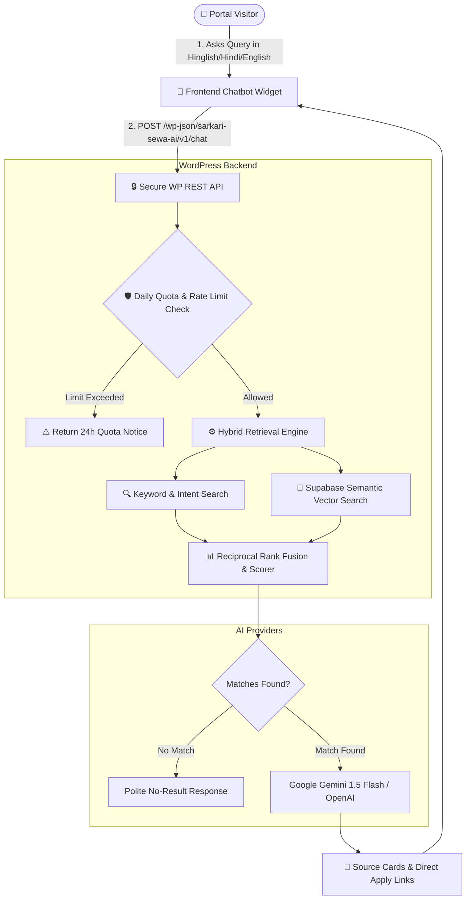

# Sarkari Sewa AI 🇮🇳 🤖

[](https://wordpress.org)
[](https://www.php.net)
[](https://ai.google.dev)
[](https://supabase.com)
[](LICENSE)

> **Sarkari Sewa AI** is a production-grade, source-grounded AI search assistant WordPress plugin engineered specifically for government job, admit card, exam result, and answer key information portals like [SarkariSewa.com](https://sarkarisewa.com).

---

## 🌟 Key Features

- 🎯 **Strict Anti-Hallucination Grounding**: Answers are strictly grounded in published website content. If no matching notification exists in the database, the AI politely informs the user rather than fabricating dates or links.
- ⚡ **Hybrid Retrieval Architecture**: Combines WordPress local full-text search with **Supabase `pgvector` HNSW** semantic vector embeddings for sub-200ms latency.
- 💰 **24-Hour Daily Message Quotas**: Admin-configurable per-user query limits (e.g., 10 or 20 messages/day) to prevent API bill inflation and spam bots.
- 🌐 **Multilingual & Hinglish Support**: Fluently understands user inquiries in Hindi, English, and conversational Hinglish (e.g., *"Railway ki latest vacancy aayi kya?"*).
- ✨ **Ultra-Modern Animated UI**: Floating animated robot avatar, glowing pulse rings, high-contrast verified badge, prominent close controls, and mobile-optimized slide-in drawers.
- 🔄 **Automated Lifecycle Indexing**: Hooks seamlessly into WordPress post publishing, editing, and trashing to keep vector embeddings permanently in sync.

---

## 🏛️ System Architecture



---

## 🚀 Quick Installation Guide

### Option 1: Install via WordPress Admin (Recommended)

1. Download [`sarkari-sewa-ai.zip`](sarkari-sewa-ai.zip) from this repository.
2. In your WordPress Admin dashboard, navigate to **Plugins → Add New → Upload Plugin**.
3. Select `sarkari-sewa-ai.zip`, click **Install Now**, and then click **Activate Plugin**.

---

### Option 2: Supabase Vector Database Setup (1 Minute)

1. Create a free project at [Supabase.com](https://supabase.com).
2. Open the **SQL Editor** in your Supabase dashboard and run the following setup script:

```sql
-- Enable vector extension
CREATE EXTENSION IF NOT EXISTS vector;

-- Create documents table (768 dimensions for Gemini text-embedding-004)
CREATE TABLE IF NOT EXISTS sarkari_ai_documents (
    id BIGSERIAL PRIMARY KEY,
    post_id BIGINT NOT NULL,
    post_title TEXT NOT NULL,
    post_url TEXT NOT NULL,
    category TEXT DEFAULT '',
    last_date TEXT DEFAULT '',
    content_chunk TEXT NOT NULL,
    embedding VECTOR(768),
    created_at TIMESTAMP WITH TIME ZONE DEFAULT NOW()
);

-- Create HNSW high-speed vector index
CREATE INDEX IF NOT EXISTS sarkari_ai_docs_embedding_hnsw_idx 
ON sarkari_ai_documents 
USING hnsw (embedding vector_cosine_ops);

-- Create similarity search RPC function
CREATE OR REPLACE FUNCTION match_documents (
  query_embedding VECTOR(768),
  match_threshold FLOAT,
  match_count INT
)
RETURNS TABLE (
  id BIGINT,
  post_id BIGINT,
  post_title TEXT,
  post_url TEXT,
  category TEXT,
  last_date TEXT,
  content_chunk TEXT,
  similarity FLOAT
)
LANGUAGE plpgsql
AS $$
BEGIN
  RETURN QUERY
  SELECT
    sarkari_ai_documents.id,
    sarkari_ai_documents.post_id,
    sarkari_ai_documents.post_title,
    sarkari_ai_documents.post_url,
    sarkari_ai_documents.category,
    sarkari_ai_documents.last_date,
    sarkari_ai_documents.content_chunk,
    1 - (sarkari_ai_documents.embedding <=> query_embedding) AS similarity
  FROM sarkari_ai_documents
  WHERE 1 - (sarkari_ai_documents.embedding <=> query_embedding) > match_threshold
  ORDER BY similarity DESC
  LIMIT match_count;
END;
$$;
```

---

## ⚙️ Plugin Configuration

In your WordPress Admin sidebar, go to **Sarkari Sewa AI → Settings**:

1. **AI Provider Tab**: Select **Google Gemini**, paste your API Key from [Google AI Studio](https://aistudio.google.com/app/apikey).
2. **Vector DB Tab**: Select **Supabase**, enter your `Project URL` and `service_role Secret Key`.
3. **Security & Privacy Tab**: Set your preferred **Daily Message Limit per User** (Default: 10 messages per 24 hours).
4. Click **Save All Settings**.
5. Go to **Sarkari Sewa AI → Dashboard** and click **Run Health Check** to confirm all green checkmarks.
6. Go to **Sarkari Sewa AI → Content Index** and click **Start Bulk Indexing** to sync your posts!

---

## 📁 Repository Directory Structure

```
Sarkari-Sewa-Ai/
├── sarkari-sewa-ai.zip                  # Ready-to-install WordPress plugin archive
├── sarkari-sewa-ai/                     # Core plugin directory
│   ├── sarkari-sewa-ai.php              # Main bootstrap & class autoloader
│   ├── uninstall.php                    # Cleanup handler on plugin deletion
│   ├── INSTALLATION.md                  # Comprehensive technical installation guide
│   ├── API_DOCS.md                      # REST API endpoint reference
│   ├── includes/                        # Modular PHP Architecture
│   │   ├── class-activator.php          # Database tables creation & default options
│   │   ├── class-deactivator.php        # Safe deactivation routines
│   │   ├── class-admin.php              # Admin menus, health checks & AJAX handlers
│   │   ├── class-ai-provider.php        # AI Provider Interface & Factory
│   │   ├── class-gemini-provider.php    # Gemini 1.5 Flash Chat & text-embedding-004
│   │   ├── class-openai-provider.php    # OpenAI GPT-4o-mini & text-embedding-3-small
│   │   ├── class-vector-provider.php    # Vector Store Interface & Factory
│   │   ├── class-supabase-provider.php  # Supabase REST client & RPC executor
│   │   ├── class-search-engine.php      # Hybrid search & ranking fusion engine
│   │   ├── class-keyword-search.php     # WordPress DB keyword & intent matching
│   │   ├── class-semantic-search.php    # Vector similarity search pipeline
│   │   ├── class-chat-controller.php    # Chat orchestration & anti-hallucination gate
│   │   ├── class-content-indexer.php    # Bulk batch chunking & vector sync
│   │   ├── class-rate-limiter.php       # 24-hour daily quotas & IP burst protection
│   │   ├── class-security.php           # Sanitization, XSS & prompt injection defense
│   │   └── class-logger.php             # Diagnostic activity & error logging
│   ├── admin/                           # WordPress Admin Dashboard Views & Assets
│   │   ├── css/admin.css
│   │   ├── js/admin.js
│   │   └── views/                       # Dashboard, Settings, Indexer, Search Test, Logs
│   ├── public/                          # Frontend Chatbot Assets
│   │   ├── css/chatbot.css              # Animated robot styling & responsive layout
│   │   └── js/chatbot.js                # Chat stream, session storage & daily quota UI
│   └── templates/                       # Semantic HTML templates
│       ├── chatbot.php                  # Floating widget markup
│       ├── message.php                  # Bubble message templates
│       └── source-card.php              # Rich post citation card
```

---

## 🔒 Security & Privacy

- **Zero Exposure**: Secret API keys (Gemini & Supabase) reside strictly server-side in PHP options and are **never** exposed to browser JavaScript.
- **REST Nonce Verification**: All chat queries are validated through WordPress REST nonces and rate-limited by client IP.
- **Strict Content Boundary**: The system prompt instructs the model to ignore injection attempts and only answer using the provided official government job post context.

---

## 📜 License

This project is licensed under the **GNU General Public License v2.0 or later** — see the [LICENSE](LICENSE) file for details.
